<div align="center">

# 🚗  덜컹덜컹 달려간다 ~ 연저씨 🚗

### "너의 연수 아저씨" - 초보 운전자를 위한 차량 조작 퀘스트 앱

현대 Pleos Connect 차량용 앱 개발 공모전 출품작


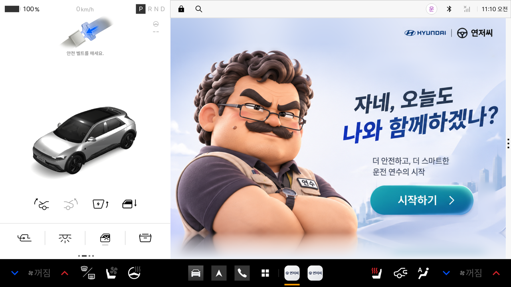

<a href="docs/demo/yeonjeossi-demo.mp4">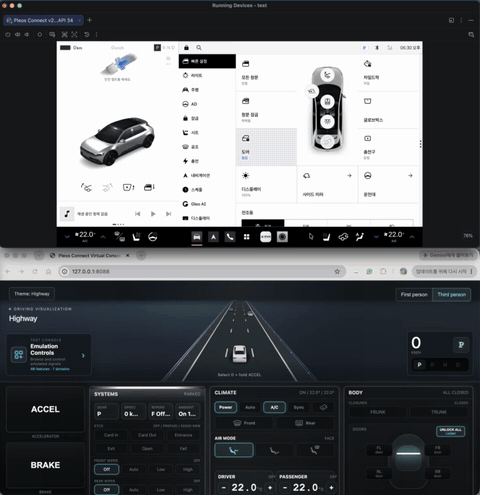</a>

**[▶ 전체 구현 영상 보기 (약 1분 30초)](docs/demo/yeonjeossi-demo.mp4)**

</div>

---

## 📖 목차

1. [왜 만들었는지?](#왜-만들었는지)
2. [핵심 기능](#핵심-기능)
3. [화면 둘러보기](#화면-둘러보기)
4. [사용 흐름](#사용-흐름)
5. [퀘스트 완료 확인법](#퀘스트-완료-확인법)
6. [퀘스트 구성](#퀘스트-구성)
7. [사용한 Pleos SDK](#사용한-pleos-sdk)
8. [코드 구조](#코드-구조)
9. [실행 방법](#실행-방법)
10. [한계점 및 제약](#한계점-및-제약)

---

##  왜 만들었는지?  


**연저씨**는 차량 데이터 기반 맞춤형 코칭과 실전 퀘스트를 통해 초보운전자의 운전 실력을 키워주는 AI 운전 연수 앱입니다.  
퀘스트를 하나씩 깨면서 실제 차량 조작을 익히고, 앱은 차량이 보내는 신호로 제대로 했는지 확인해 줍니다.  
말투가 구수한 연저씨가 옆에서 알려주는 형식이라 딱딱하지 않아서 기분 좋게 배울 수 있습니다.

---

##  핵심 기능

| 기능 | 설명 |
|---|---|
|  **차량 조작 퀘스트 29개** | 문, 방향지시등, 와이퍼, 전조등, 창문, 공조, 주행 기능, 내비·음성, 전기차까지 9개 카테고리 |
|  **차량 신호로 완료 확인** | Pleos Vehicle SDK로 실제 상태 변화를 읽어 단계를 판정 |
|  **일상 퀘스트 42개** | 주유소, 드라이브스루, 주차, 고속도로, 보호구역 등 9개 카테고리의 실제 운전 상황 |
|  **음성·내비 퀘스트** | 목적지 음성 검색, 경유지 추가, 주유소·충전소 음성 검색을 직접 말하고 조작하면 인식 결과와 내비 이벤트로 자동 완료 |
|  **내비 연동** | 일상 퀘스트에서 경로 시작과 도착 신호를 NaviHelper로 받고, 연저씨가 음성(TTS)으로 안내 |
|  **기록과 뱃지** | 완료한 퀘스트, 최근 기록, 카테고리를 모두 깨면 받는 뱃지를 마이페이지에 모아 보여줌 |
|  **화면별 도움말** | 모든 화면의 같은 자리(우측 상단)에서 도움말 오버레이로 설명 |
|  **차량용 디자인** | 가로형 차량 디스플레이에 맞춘 큰 글씨, 큰 카드, 하나로 통일된 그라데이션 배경 |

---

##  화면 둘러보기

Pleos Connect 에뮬레이터에서 직접 캡처한 화면입니다.

<table>
<tr>
<td width="50%">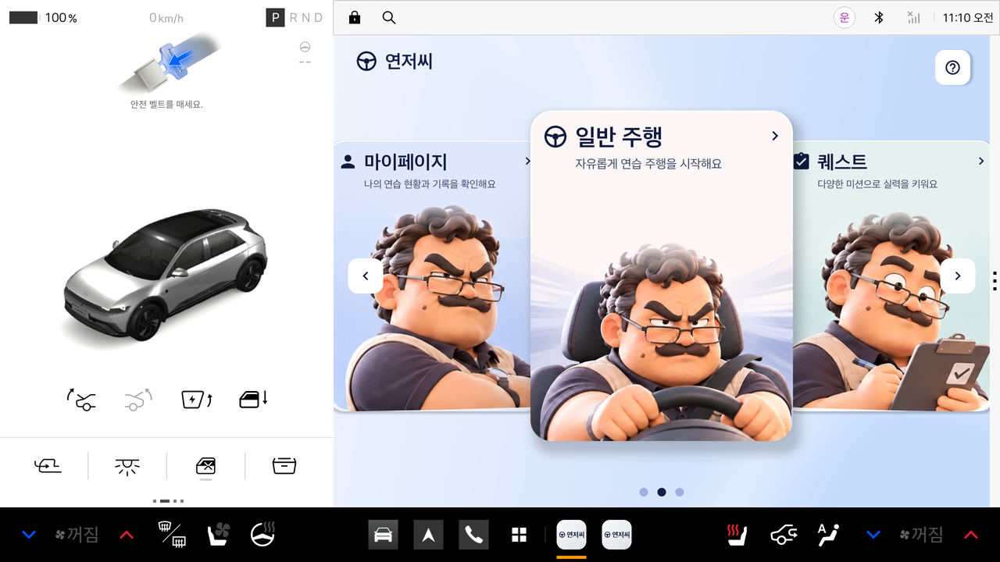<br><b>메인</b><br>마이페이지 · 일반 주행 · 퀘스트를 카드로 선택</td>
<td width="50%">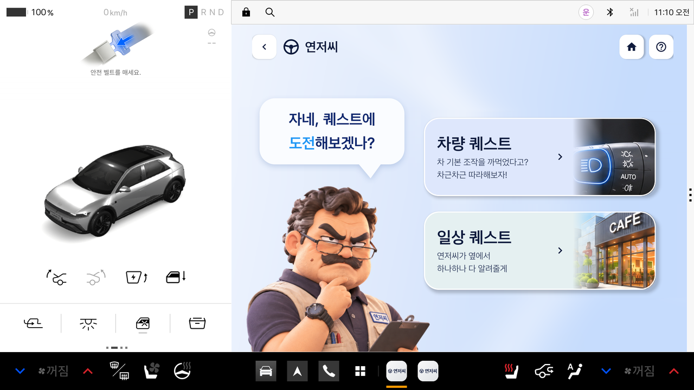<br><b>퀘스트 종류</b><br>차량 퀘스트와 일상 퀘스트 중 선택</td>
</tr>
<tr>
<td>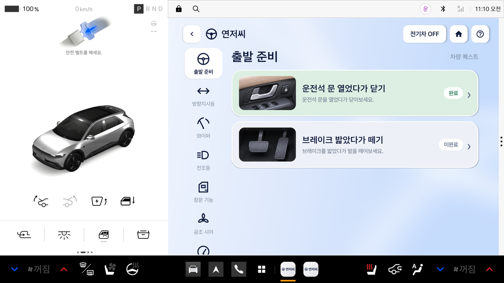<br><b>차량 퀘스트 목록</b><br>카테고리별 목록과 완료 · 미완료 표시</td>
<td>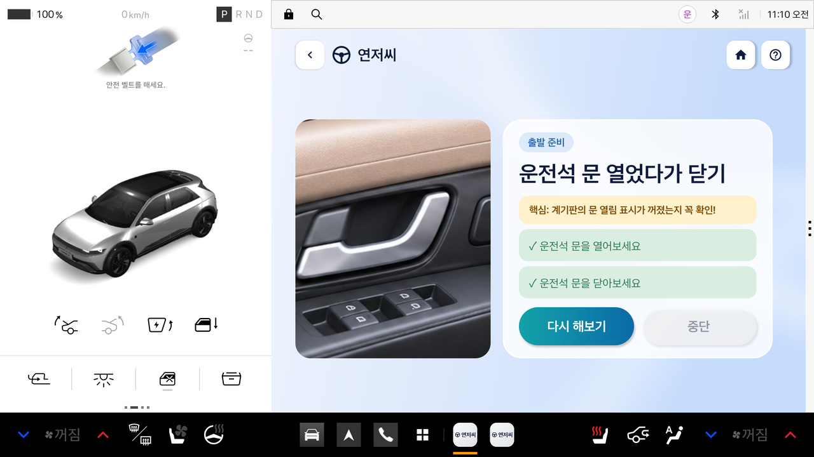<br><b>퀘스트 진행</b><br>사진, 핵심 포인트, 단계별 체크</td>
</tr>
<tr>
<td>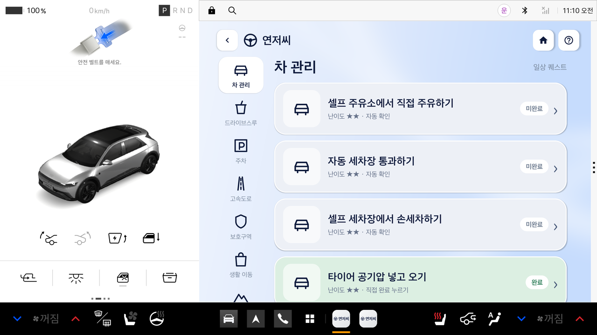<br><b>일상 퀘스트 목록</b><br>난이도(별)와 확인 방식 표시</td>
<td>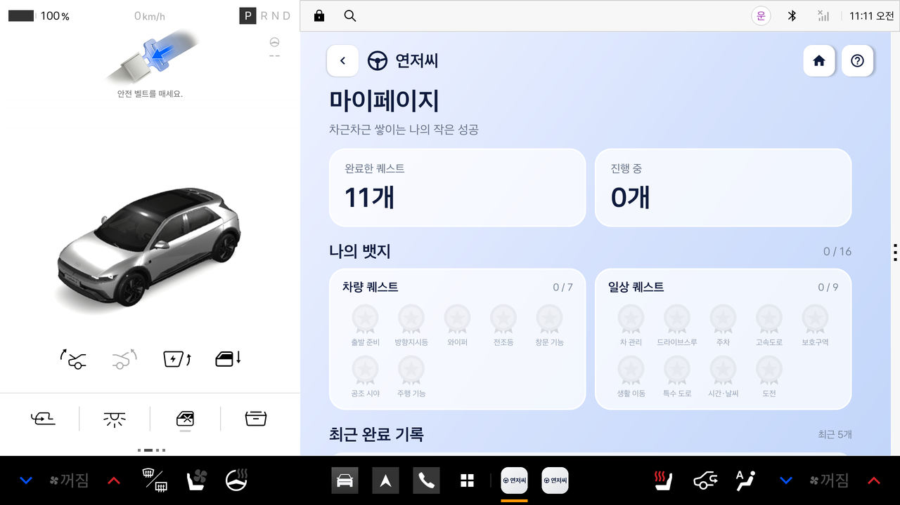<br><b>마이페이지</b><br>완료 개수, 카테고리 뱃지, 최근 기록</td>
</tr>
<tr>
<td colspan="2" align="center">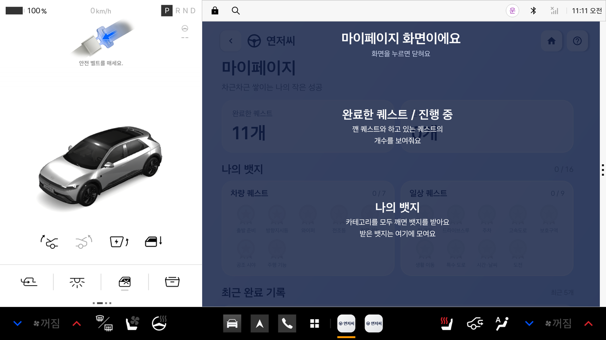<br><b>도움말 오버레이</b><br>화면 요소가 무엇인지 어둡게 덮고 글씨로 설명</td>
</tr>
</table>

---

##  사용 흐름

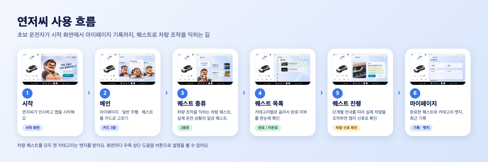

---

##  퀘스트 완료 확인법

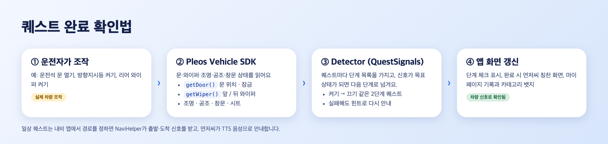

예를 들어 "리어 와이퍼 켰다가 끄기" 퀘스트는 다음처럼 동작합니다.

| 단계 | 앱이 안내하는 말 | 앱이 읽는 신호 |
|---|---|---|
| 1 | 리어 와이퍼를 켜보세요 | `getWiper().getCurrentWiperState(REAR_WINDSHIELD)`가 작동 중 |
| 2 | 리어 와이퍼를 꺼보세요 | 같은 신호가 정지 |

신호가 목표 상태가 되면 다음 단계로 넘어가고, 마지막 단계까지 끝내면 연저씨의 칭찬 화면과 함께 기록이 저장됩니다.

**판정이 잘못되지 않게 한 장치**

| 문제 | 처리 |
|---|---|
| 다른 모드로 바꿨는데 "껐다"고 잘못 완료됨 | 차량이 실제로 보내는 "꺼짐" 값일 때만 완료로 인정. 다른 모드로 바뀐 상태는 완료가 아님 |
| 다시 연습하다 중단하면 예전 완료 상태와 기록이 사라짐 | 재연습을 중단해도 기존 완료 상태와 기록을 그대로 유지 |
| 퀘스트 목록이 바뀌면 기존 기록이 다른 항목에 잘못 붙음 | 기록을 퀘스트 이름이 아닌 고유 ID로 연결하고, 이전 기록은 지우지 않고 이관 |
| 화면을 벗어나거나 늦게 온 응답이 판정에 반영됨 | 화면을 나간 뒤 도착한 응답은 판정에서 제외 |

---

##  퀘스트 구성

### 차량 퀘스트 (29개)

| 카테고리 | 개수 | 대표 퀘스트 |
|---|:---:|---|
| 출발 준비 | 2 | 운전석 문 열었다가 닫기, 브레이크 밟았다가 떼기 |
| 방향지시등 | 2 | 왼쪽 · 오른쪽 방향지시등 켰다가 끄기 |
| 와이퍼 | 5 | 와이퍼 켰다가 끄기, 자동 · 저속 · 고속, **리어 와이퍼** |
| 전조등 | 2 | 하향등, 상향등 켰다가 끄기 |
| 창문 기능 | 4 | 운전석 창문, 전체 문 잠금, 트렁크, 프렁크 |
| 공조 시야 | 7 | 에어컨, 온도, 송풍 방향, 내기순환 → 외기, 앞유리 성에 제거, **뒷유리 열선**, 시트 통풍 |
| 주행 기능 | 2 | 운전대 돌렸다가 풀기, 크루즈 켰다가 끄기 (크루즈는 꺼짐 신호를 확인할 수 없어 자동 판정 보류) |
| 내비·음성 | 3 | 목적지 음성 검색, 경유지 추가, 주유소·충전소 음성 검색 |
| 전기차 | 2 | 충전구 열었다가 닫기, 충전 상태 확인 (전기차 모드를 켰을 때만 표시) |

> 크루즈 켰다가 끄기는 차량 신호로 "꺼짐"을 정확히 확인할 수 없어 자동 판정을 보류했습니다. 목록에는 "구현 중"으로 표시되고 눌러도 열리지 않으며, 이 퀘스트를 하지 않아도 주행 기능 뱃지를 받을 수 있습니다.


### 일상 퀘스트 (42개)

| 카테고리 | 개수 | 예시 |
|---|:---:|---|
| 차 관리 | 6 | 셀프 주유소에서 직접 주유하기, 자동 세차장 통과하기 |
| 드라이브스루 | 4 | 카페 드라이브스루 주문하기, 약국 드라이브스루 이용하기 |
| 주차 | 5 | 대형마트 지하주차장 주차, 백화점 나선형 주차장, 기계식 주차타워 |
| 고속도로 | 5 | 하이패스 톨게이트 통과하기, 휴게소에서 쉬고 다시 출발하기 |
| 보호구역 | 4 | 어린이보호구역 통과하기, 노인보호구역 통과하기 |
| 생활 이동 | 5 | 기차역에서 사람 태워 오기, 공항 출국장 앞에서 내려주기 |
| 특수 도로 | 5 | 한강 다리 건너기, 긴 터널 통과하기, 산 고갯길 넘어가기 |
| 시간 · 날씨 | 4 | 야간 드라이브, 비 오는 날 장보고 오기 |
| 도전 | 4 | 처음 가보는 도시 다녀오기, 왕복 100km 드라이브 |

난이도는 별 2개에서 4개까지입니다. 
일상 퀘스트는 내비로 경로를 정하면 도착 신호를 받아 이어지고, 직접 확인이 필요한 4개는 사용자가 완료를 눌러 마칩니다.

---

##  사용한 Pleos SDK

| SDK | 버전 | 앱에서 하는 일 |
|---|---|---|
| **Vehicle** | 2.3.2 | 문, 와이퍼, 조명, 공조, 창문, 충전구, 배터리 충전율을 읽어 퀘스트 단계를 판정 |
| **NaviHelper** | 3.0.5 | 일상 퀘스트의 경로 시작과 도착 신호, "경유지 추가" 퀘스트의 경유지 변경 신호 수신 |
| **TextToSpeech** | 3.3.1 | 연저씨의 음성 안내 (남성 목소리) |
| **FusedLocation** | 1.1.3 | 위치 수신 |
| **SpeechToText** | 3.3.1 | "목적지 음성 검색", "주유소·충전소 검색" 퀘스트에서 말한 문장을 인식해 판정 |

> TextToSpeech, FusedLocation, SpeechToText는 Playground에서 "준비 중"으로 표시된 SDK입니다. 

요청하는 차량 권한은 `app/src/main/AndroidManifest.xml`에 있고, Maven 저장소는 `settings.gradle.kts`에 등록되어 있습니다.

---

##  코드 구조

모든 화면 코드는 `app/src/main/java/com/example/test/yeonsu/`에 있습니다.

```
화면
├── LoadingActivity → StartActivity → HomeActivity   시작과 메인 (카드 3장)
├── QuestTypesActivity                                 퀘스트 종류 선택
├── QuestListActivity                                  카테고리별 퀘스트 목록
├── QuestDetailActivity                                퀘스트 진행 (단계, 사진, 시작/중단)
├── QuestDoneActivity                                  완료 화면 (연저씨 표정 6종)
├── DailyFlowActivity · ScenarioActivity               일상 퀘스트 (내비, 음성 안내)
├── RecordsActivity                                    마이페이지 (기록, 뱃지)
└── DriveLoadingActivity → DriveActivity               일반 주행 안내

공통
├── FadeActivity       모든 화면의 부모. 화면 전환에 페이드인을 적용
├── ScreenActivity     헤더, 배경, 도움말을 갖춘 화면 틀
├── HeaderBar          상단 바. 도움말 버튼이 모든 화면에서 같은 자리
└── HelpOverlay        도움말 오버레이

데이터와 판정
├── QuestData          퀘스트 목록, 진행 상태 저장, 뱃지
└── QuestSignals       퀘스트별 차량 신호 판정 (Detector)
```

---

##  실행 방법

1. Android Studio에서 이 폴더를 열고 **Sync Project with Gradle Files**를 실행합니다. (`local.properties`는 자동 생성됩니다.)
2. 실행 기기를 **Pleos Connect 에뮬레이터**로 선택합니다. (AVD 이름 예: `Pleos_Connect_v2.1.0`)
3. ▶ Run을 누르면 로딩 후 연저씨 시작 화면이 뜹니다.

앱은 에뮬레이터의 `운전자` 사용자 계정에서 실행됩니다. 요구 환경은 Android SDK API 34 이상, minSdk 28, Kotlin입니다.

---

##  한계점 및 제약

- 앱이 스스로 분할 화면을 만들 수 없다는 점 -> 일반 주행은 내비를 켠 뒤 손잡이를 왼쪽으로 끌어 오른쪽 1/3에 연저씨를 놓는 방식으로 대체
- 에뮬레이터에서는 `PERF_VEHICLE_SPEED`가 없음 -> 그래서 아러한 일부 퀘스트는 실차에서만 확인할 수 있음
- 일반 주행 화면의 일부 기능은 아직 구현 중. 실제 경로와 연결되지 않은 고정 회전·제동 안내 음성은 잘못된 안내가 나오지 않도록 꺼 둠
- 크루즈 켰다가 끄기는 꺼짐 신호를 확인할 수 없어 자동 판정을 보류함 (대기 상태는 꺼짐이 아님)
- 음성 퀘스트(목적지, 주유소·충전소)는 인식된 문장으로 판정해서 "부분 가능" 상태. 말한 내용이 실제로 목적지인지까지는 확인하지 못함
- "충전 상태 확인"은 배터리 충전율 값이 바뀌면 완료로 처리

---

<div align="center">

**덜컹덜컹 달려가는 연저씨...** 🚗🚗🚗

</div>
